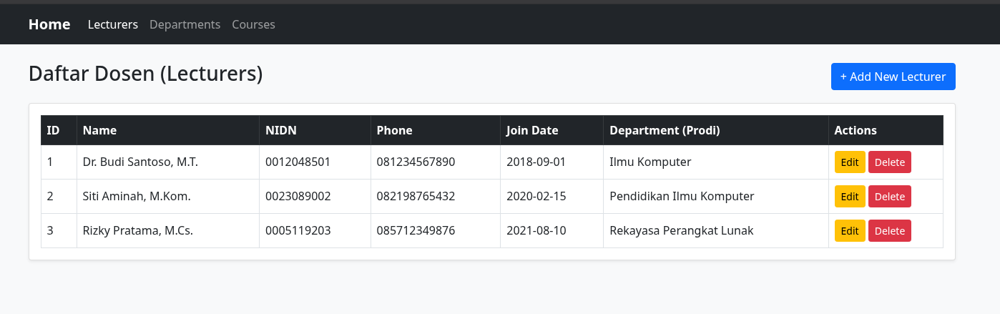
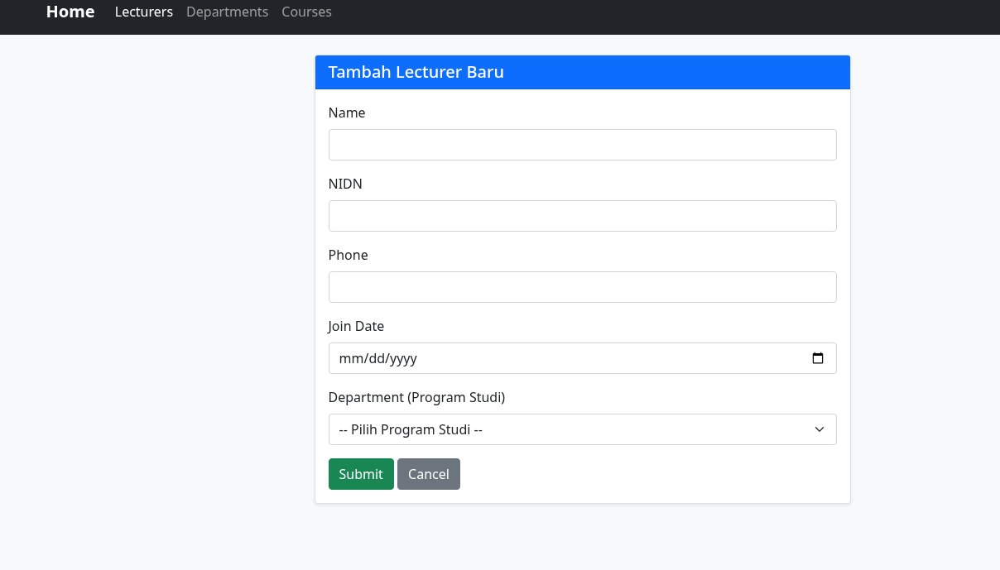
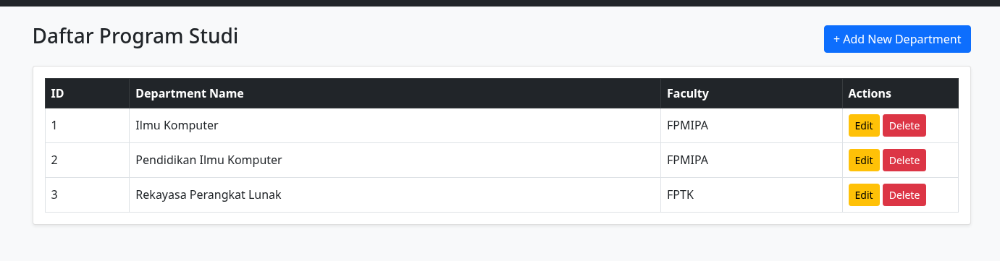
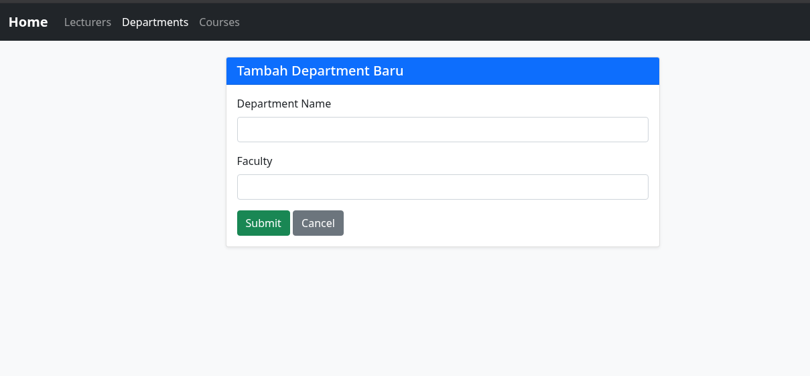
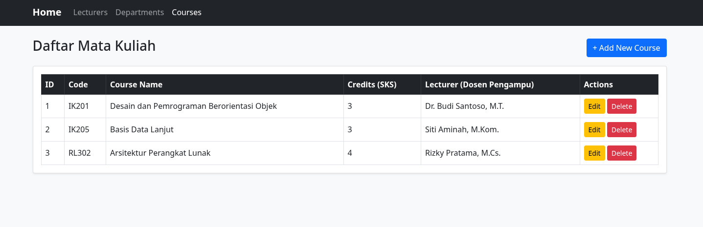
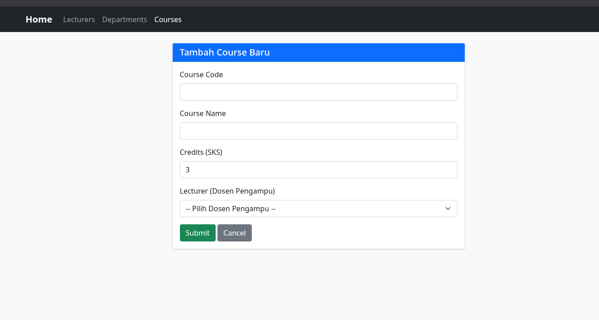

# TP8DPBO2526C2

## Janji
Saya Rhafa Farell Valeno dengan NIM 2508020 mengerjakan Tugas Praktikum 8 dalam mata kuliah Desain dan Pemrograman Berorientasi Objek. Saya tidak melakukan kecurangan seperti yang telah dispesifikasikan. Aamiin.

## Desain Program
Aplikasi ini mengelola data akademik berupa program studi, dosen, dan mata kuliah. Program dibuat dengan PHP Native berorientasi objek, MySQL/MariaDB, pola **Model-View-Controller (MVC)**, dan Bootstrap 5.

Pembagian tanggung jawab program:

- **Config (`Project/config/Database.php`)** membuat koneksi `mysqli` ke database `tp_mvc25`.
- **Model (`Project/models/`)** menjalankan operasi data untuk `Department`, `Lecturer`, dan `Course`. Operasi yang menerima nilai menggunakan prepared statement.
- **Controller (`Project/controllers/`)** menangani aksi daftar, tambah, ubah, dan hapus, serta menghubungkan model dengan view.
- **View (`Project/views/`)** menampilkan halaman daftar dan formulir untuk setiap jenis data. Layout bersama berada di `views/layouts/`.
- **Front controller (`Project/index.php`)** menjadi pintu masuk aplikasi dan memilih controller serta aksi berdasarkan parameter URL.
- **Assets (`Project/assets/`)** menyediakan Bootstrap CSS dan JavaScript secara lokal.

### Relasi Data
Database `tp_mvc25` mempunyai tiga tabel:

| Tabel | Atribut utama | Relasi |
| --- | --- | --- |
| `departments` | `id`, `department_name`, `faculty` | Satu program studi dapat memiliki banyak dosen. |
| `lecturers` | `id`, `name`, `nidn`, `phone`, `join_date`, `department_id` | Dosen dapat terkait ke satu program studi; `department_id` boleh kosong. |
| `courses` | `id`, `course_code`, `course_name`, `credits`, `lecturer_id` | Mata kuliah dapat terkait ke satu dosen; `lecturer_id` boleh kosong. |

Foreign key `lecturers.department_id` mengarah ke `departments.id`. Jika program studi dihapus, nilai `department_id` dosen terkait menjadi `NULL` (`ON DELETE SET NULL`). Foreign key `courses.lecturer_id` mengarah ke `lecturers.id`; jika dosen dihapus, mata kuliah yang terkait ikut dihapus (`ON DELETE CASCADE`).

## Alur Aplikasi
1. Pengguna membuka `Project/index.php`. Jika parameter tidak diberikan, aplikasi menampilkan daftar dosen.
2. `index.php` membuat koneksi database, membaca parameter `controller` dan `action`, lalu membuat controller yang sesuai. Controller yang tersedia adalah `lecturer`, `department`, dan `course`.
3. Controller meminta atau mengubah data melalui model. Untuk halaman formulir, controller juga mengambil data relasi yang dibutuhkan, seperti daftar program studi pada formulir dosen dan daftar dosen pada formulir mata kuliah.
4. Controller memuat view yang sesuai. Formulir dikirim dengan metode POST; setelah tambah, ubah, atau hapus, aplikasi mengarahkan pengguna kembali ke halaman daftar terkait.

Contoh URL halaman daftar:

```text
index.php?controller=lecturer&action=index
index.php?controller=department&action=index
index.php?controller=course&action=index
```

Setiap entitas mendukung operasi **Create, Read, Update, Delete (CRUD)**. Jika aksi yang diminta tidak tersedia, front controller menjalankan aksi `index` milik controller tersebut.

## Dokumentasi
### Rekaman Layar
Rekaman layar demo aplikasi tersedia di [`Dokumentasi/demo.webm`](Dokumentasi/demo.webm). Buka tautan tersebut untuk memutar atau mengunduh video.

<video controls width="720" src="Dokumentasi/demo.webm">
  Browser Anda tidak mendukung pemutar video. Buka <a href="Dokumentasi/demo.webm">rekaman demo</a>.
</video>

### Tangkapan Layar
**Daftar dosen**



**Form tambah dosen**



**Daftar program studi**



**Form tambah program studi**



**Daftar mata kuliah**



**Form tambah mata kuliah**



## Struktur Direktori
```text
TP8DPB02526C2/
├── Dokumentasi/
│   ├── tampilan_add_dosen.png
│   ├── tampilan_add_matkul.png
│   ├── tampilan_add_prodi.png
│   ├── tampilan_dosen.png
│   ├── tampilan_matkul.png
│   └── tampilan_prodi.png
├── Project/
│   ├── assets/
│   │   ├── bootstrap.bundle.min.js
│   │   └── bootstrap.min.css
│   ├── config/
│   │   └── Database.php
│   ├── controllers/
│   │   ├── CourseController.php
│   │   ├── DepartmentController.php
│   │   └── LecturerController.php
│   ├── models/
│   │   ├── Course.php
│   │   ├── Department.php
│   │   └── Lecturer.php
│   ├── views/
│   │   ├── courses/
│   │   ├── departments/
│   │   ├── layouts/
│   │   └── lecturers/
│   ├── index.php
│   └── tp_mvc25.sql
└── README.md
```

## Persiapan dan Menjalankan
1. Pastikan PHP dengan ekstensi `mysqli` dan MySQL/MariaDB tersedia.
2. Impor `Project/tp_mvc25.sql` ke MySQL/MariaDB. Skrip membuat database `tp_mvc25`, tabel, relasi, dan data contoh.
3. Periksa konfigurasi koneksi pada `Project/config/Database.php`. Nilai bawaan: host `localhost`, pengguna `root`, kata sandi kosong, dan database `tp_mvc25`. Sesuaikan dengan konfigurasi lokal.
4. Jalankan server PHP dari direktori `Project/`:

   ```bash
   cd Project
   php -S localhost:8000
   ```

5. Buka [http://localhost:8000](http://localhost:8000) di browser.
